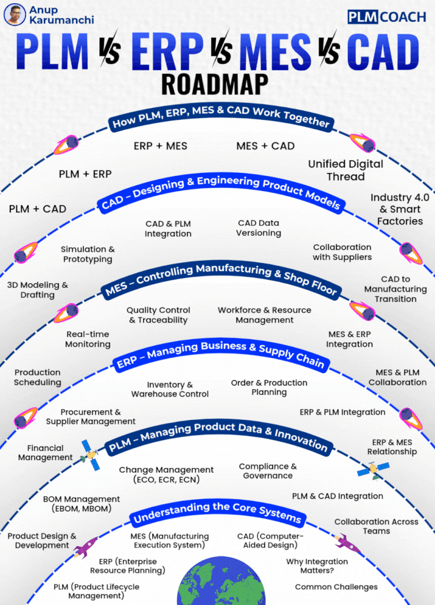

# The 11 Core MES Modules

## The 11 Core MES Modules — and What Each One Delivers
A production-grade MES is not a single application — it is an integrated suite of functional modules. Each module targets a specific operational failure mode and contributes independently measurable ROI. Here is what every operations leader needs to understand about each one.

### 01 Production Scheduling and Dispatching
Translates ERP work orders into optimised, real-time shop floor sequences. Dynamic rescheduling responds to machine breakdowns, material shortages, and rush orders without manual intervention. Reduces schedule adherence gaps by 40–60%.
### 02 Work-in-Progress (WIP) Tracking
Provides real-time location and status of every job, lot, and unit across the production floor. Eliminates lost WIP, reduces cycle time variance, and gives supervisors immediate visibility without walking the floor.
### 03 Quality Management and SPC
Captures in-process inspection data, enforces pass/fail gates, and runs Statistical Process Control charts in real time. Defects are caught at the source — not at final inspection or, worse, at the customer.
### 04 Labor Management
Tracks actual versus standard labor hours by operation, operator, and work center. Identifies productivity bottlenecks, enables skills-based dispatching, and provides data for accurate job costing.
### 05 Materials and Inventory Control
Manages real-time raw material consumption, component traceability, and floor stock replenishment. Eliminates material shortages that stop production lines and reduces excess WIP inventory by 20–35%.
### 06 OEE and Performance Analytics
Calculates Overall Equipment Effectiveness from live machine data — availability, performance, and quality rates. Identifies the biggest throughput losses and quantifies them in dollars, not percentages.
### 07 Document and Recipe Management
Delivers the correct work instructions, drawings, and process parameters to operators at the point of use. Eliminates version control failures — the leading cause of first-article rejections and customer non-conformances.
### 08 Genealogy and Traceability
Records the complete production history of every serialised or lot-controlled unit — components used, machines run on, operators who touched it, conditions at each step. Reduces recall scope by 70–90% and satisfies FDA 21 CFR Part 11, IATF 16949, and AS9100 requirements.
### 09 Maintenance Integration (MES-Maint)
Connects production events to maintenance workflows. Unplanned downtime triggers automatic work orders. Planned maintenance windows are coordinated with production scheduling to minimise impact on throughput.
### 10 Energy Monitoring
Tracks energy consumption by machine, shift, and product. Correlates energy cost with production output to identify the true cost-per-unit and surface energy waste that utility bills alone cannot reveal.
### 11 ERP and SCADA Integration
Bi-directional data exchange via OPC-UA, REST, and SAP/Oracle connectors. MES becomes the live data source that makes ERP planning accurate and SCADA data operationally meaningful.

