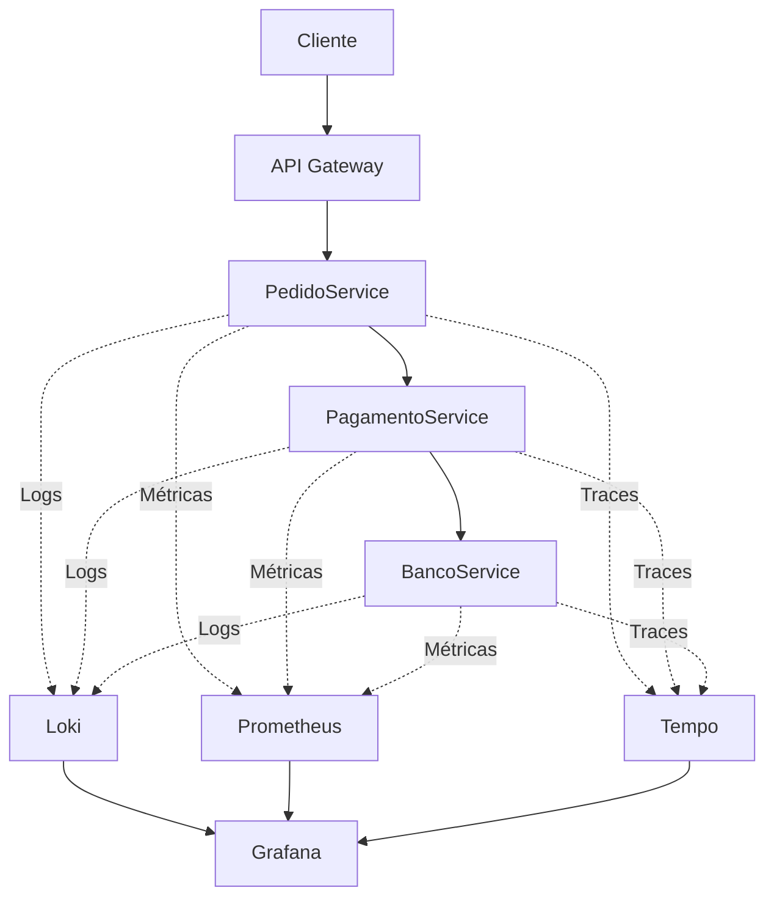
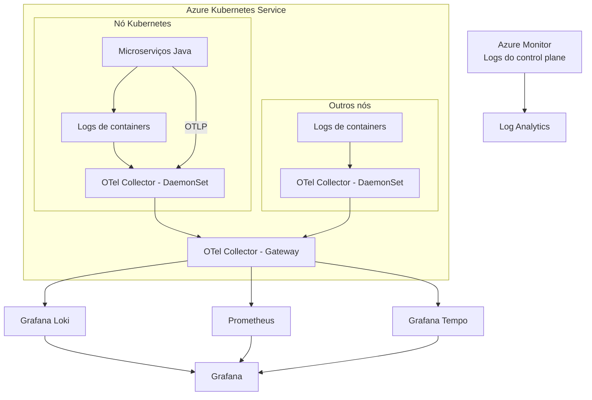
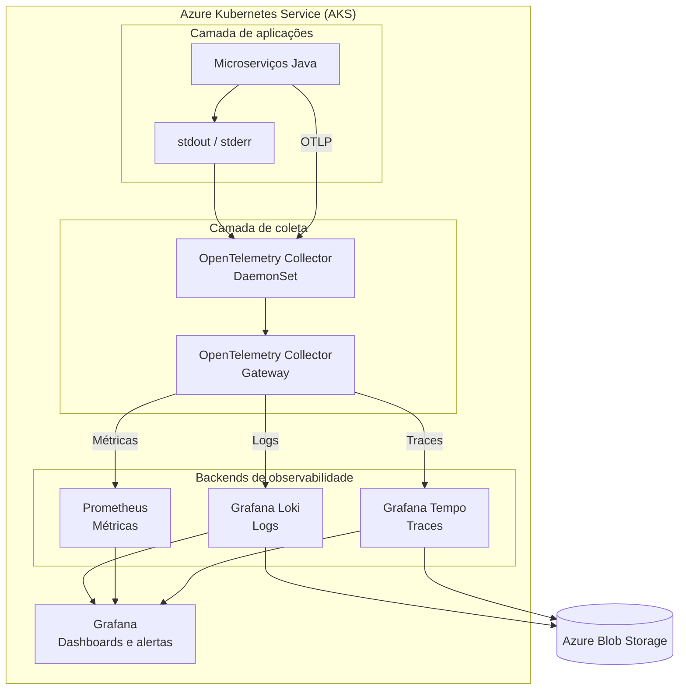

# Prompt
Olá... Preciso desenvolver um desenho de arquitetura de observabilidade e eu estou pensando em usar OpenTelemetry e Prometheus ou Loki como back-end

# ChatGPT
Boa escolha. Em geral, você usa o OpenTelemetry para padronizar a coleta, com o Collector recebendo traces, métricas e logs. Pro métricas cuida muito bem das métricas, e Grafana é o front-end para visualizar tudo. Já o Loki é o equivalente para logs no ecossistema Grafana, especialmente se você quer algo integrado e escalável. Uma topologia comum é: aplicações instrumentadas com OpenTelemetry SDK, mandando para o Collector, que exporta métricas para o Prometheus e logs para o Loki, com o Grafana consumindo ambos para os dashboards e alertas. Quer focar primeiro na parte de logs ou de métricas?

# Prompt
Quero focar em logs

# ChatGPT
Perfeito, então, pra logs, o caminho mais limpo seria padronizar o formato dos eventos na aplicação, por exemplo, usando JSON com campos de nível, serviço, trace-id, mensagem e atributos. O OpenTelemetry Collector recebe esses logs pelo OTLP ou HTTP, e encaminha para o Loki. Assim você centraliza a ingestão, em vez de cada app falar direto com o Loki. Quer que eu descreva o fluxo em nível de componentes, tipo caixinhas e setas, pra você desenhar rapidinho?

# Prompt
Perfeito, sim.

# ChatGPT
Show , começa com suas aplicações emitindo logs em JSON já com o trace-id se você usa tracing. Esses logs vão para o OpenTelemetry Collector, que pode fazer parsing, adicionar labels, e exportar para o Loki. O Loki armazena os logs indexando só labels, o conteúdo fica em storage barato, e o Grafana consulta e exibe. No desenho, pensa em três caixinhas: Apps, OTel Collector, Loki e Grafana na ponta. Se quiser um rascunho ultra simples, escreve: "Apps -> OTel Collector -> Loki -> Grafana". Só isso já comunica bem. Quer que eu adapte para o seu contexto de microserviços em Kubernetes?

# Prompt
Sim. Perfeito.

# ChatGPT
Maravilha. Então, nos seus clusters, instala o OpenTelemetry Collector como um deployment ou DaemonSet, coleta stdout, stderr e arquivos de log das apps. Você configura um exporter do Collector apontando para o Loki, com labels como namespace, app, versão e nível de severidade. No Grafana, usa data sources para Loki, cria queries por labels e monta dashboards com painéis de logs correlacionados ao trace ID. Você pode até clicar do log direto para o trace, se também configurar o Tempo ou outro backend de tracing. Assim você fecha o ciclo de observabilidade no K8s com foco em logs, mas sem perder a correlação com métricas e traces.

# Prompt
Eu poderia usar o Loki em métricas e traces?

# ChatGPT
Boa pergunta, deixa eu verificar rapidinho.
Pode sim, mas com distinção importante: o Loki é para logs, não para métricas nem para traces. O caminho recomendado com OpenTelemetry é: Loki para logs, Prometheus para métricas, e, se quiser traces, usar o Tempo, tudo pluga no Grafana. Dá até pra extrair métricas a partir de logs, mas não substitui uma solução própria de métricas. Se estiver só com, só com Loki, você cobre apenas logs. Pra ter métricas e traces de verdade, complemente com Prometheus e Tempo. Quer que eu considere se vai rodar tudo no próprio Kubernetes ou usar serviços gerenciados na AWS?

# Prompt
É Kubernetes, mas eu pretendo instalar no Azure Cloud

# ChatGPT
Perfeito, então no Azure Kubernetes Service você instala o OpenTelemetry Collector como um DaemonSet para captar tudo do cluster, mantém o Loki e o Tempo em containers também, ou considera o Grafana Cloud para hospedagem gerenciada, reduzindo a carga operacional. Integre identidades com a Azure Active Directory para controlar acesso ao Grafana. E configure o exporter do Collector para enviar logs para o Loki usando storage barato, por exemplo, S3. Assim você começa enxuto e escala conforme a necessidade.

# Prompt
Entendi, então eu devo usar o Loki para logs, o Prometheus ... eu fiquei em dúvida e o tempo, quais são as utilizações

# ChatGPT
Vamos deixar bem claro aqui, só um segundinho.

Isso mesmo! Para sua arquitetura no Azure Kubernetes Service (AKS), pense nos três componentes como soluções complementares, cada uma responsável por um tipo de dado de observabilidade:

- **Loki:** responde à pergunta “O que aconteceu?” por meio dos logs.
- **Prometheus:** responde à pergunta “Como o sistema está se comportando?” por meio das métricas.
- **Tempo:** responde à pergunta “Por onde passou uma requisição e onde ocorreu a falha?” por meio dos traces distribuídos.

O **OpenTelemetry Collector** recebe, processa e encaminha esses dados, enquanto o Grafana oferece uma interface unificada para analisá-los.

### 1. Entenda cada componente na prática

Imagine que você tem dez microserviços Java executando no AKS e que uma requisição está demorando cinco segundos para responder.

| Componente | O que armazena | Exemplo de informação |
|---|---|---|
| Loki | Logs | `PagamentoService: timeout ao chamar BancoService` |
| Prometheus | Métricas | 15% das requisições estão apresentando erro |
| Tempo | Traces | A requisição passou por três serviços, e o BancoService levou 4,2 segundos |
| OpenTelemetry Collector | Coleta e encaminhamento | Recebe os dados e os envia aos backends apropriados |
| Grafana | Visualização | Reúne logs, métricas e traces em uma interface |

### 2. Como os três trabalham juntos?

Veja um exemplo de uma requisição em uma arquitetura de microserviços:

Na implementação real, o OpenTelemetry Collector pode receber e encaminhar os dados para os respectivos backends. O diagrama acima destaca a finalidade de cada sinal, não todos os componentes de transporte.

**Um detalhe importante:** para correlacionar os dados, propague o contexto de tracing entre os microserviços. Assim, os logs podem incluir o `trace_id`, permitindo navegar de um log para o trace correspondente no Grafana.

### 3. Qual é a diferença entre métricas e traces?

Essa costuma ser a principal dúvida.

**Métricas com Prometheus**

São valores numéricos agregados ao longo do tempo. Exemplos:
- Quantidade de requisições por segundo.
- Percentual de erros HTTP 500.
- Consumo de CPU e memória dos pods.
- Latência das requisições, incluindo percentis como p95 e p99.

São úteis para dashboards, alertas e identificação de tendências.

**Traces com Tempo**

Representam o caminho de uma operação distribuída. Um trace contém spans que registram operações individuais, suas durações e relações entre elas.

Por exemplo, uma requisição pode apresentar esta distribuição de tempo:

| Operação | Duração |
|---|---:|
| API Gateway | 50 ms |
| PedidoService | 100 ms |
| PagamentoService | 200 ms |
| BancoService | 4.200 ms |

Nesse cenário, o trace ajuda a identificar que o BancoService é o principal responsável pela lentidão.

Os valores são ilustrativos.

### 4. Arquitetura que eu recomendaria no Azure

Para começar com uma solução open source no AKS:

- **OpenTelemetry SDK:** instrumentação das aplicações Java.
- **OpenTelemetry Collector:** recebimento, processamento e encaminhamento de telemetria.
- **Loki:** armazenamento e consulta de logs.
- **Prometheus:** coleta e consulta de métricas.
- **Tempo:** armazenamento e consulta de traces.
- **Grafana:** dashboards, alertas e correlação entre os sinais.
- **Azure Blob Storage:** opção de armazenamento de longo prazo para os backends que suportam essa integração, conforme a configuração adotada.

Você pode executar os componentes no AKS, mas precisa dimensionar armazenamento, retenção, alta disponibilidade e recursos computacionais. Também é possível utilizar serviços gerenciados para reduzir o esforço operacional.

### 5. Minha sugestão para seu projeto

Eu implementaria primeiro **OpenTelemetry Collector + Loki + Grafana**, caso a prioridade seja centralizar logs. Depois acrescentaria Prometheus e Tempo, mantendo desde o início os identificadores de correlação e a instrumentação preparados para essa evolução.

Uma última decisão influencia bastante o desenho: **você quer coletar somente os logs gerados pelas aplicações Java ou também os logs de infraestrutura do Kubernetes, como containers, pods, nós e eventos do cluster?**

Claro. No seu caso, Loki responde à pergunta "o que aconteceu é o que aconteceu, tipo mensagens de erro, timeouts, exceções. Prometheus responde como o sistema está se comportando, ou seja, métricas de taxa de requisições, percentuais de erro, latência, uso de CPU e memória. Tempo responde por onde passou uma requisição e onde ela ficou lenta, mostrando o trace distribuído com spans entre serviços. No Grafana, você correlaciona tudo, clicando de um log para o trace, ou vendo picos de métrica e abrindo os detalhes. O OpenTelemetry Collector é a tubulação que padroniza e encaminha. Pra começar, eu faria Collector, Loki e Grafana. Depois plugaria Prometheus e Tempo, mantendo os trace IDs nos logs pra facilitar a correlação. Você quer coletar também os logs de infraestrutura do Kubernetes, ou só das aplicações Java?

# Prompt
Sim, pretendo obter logs do infra

# ChatGPT
Boa. Só deixa eu fechar a configuração aqui e te digo já já.

Nesse caso, eu desenharia a arquitetura para coletar **tanto os logs das aplicações Java quanto os logs e eventos da infraestrutura Kubernetes no Azure Kubernetes Service (AKS)**.

A principal recomendação é centralizar a coleta com OpenTelemetry Collector, mas separar as responsabilidades de coleta conforme a origem dos dados. Isso evita depender de uma única configuração para capturar informações muito diferentes.

### 1. O que coletar no AKS?

| Origem | Exemplos | Como coletar |
|---|---|---|
| Aplicações Java | Exceções, erros, regras de negócio e timeouts | Logs em JSON via stdout/stderr ou OTLP |
| Containers e pods | Saída padrão, erros e reinicializações observadas nos metadados | Coleta dos logs dos containers |
| Nós Kubernetes | Problemas do sistema operacional, kubelet e runtime | Agentes e fontes de logs do nó |
| Control plane | Auditoria e operações da API do Kubernetes | Azure Monitor, conforme a categoria de log habilitada |
| Eventos Kubernetes | Pods com falha, problemas de agendamento e falta de recursos | Coletor de eventos do cluster |
| Recursos e desempenho | CPU, memória, rede e utilização dos pods | Prometheus e/ou Azure Monitor |

**Importante:** logs, eventos e métricas são sinais diferentes. Por exemplo, o consumo de CPU de um pod é uma métrica; uma mensagem indicando que ele foi reiniciado é um evento ou registro de log.

### 2. Arquitetura proposta

Eu utilizaria um Collector como agente em cada nó Kubernetes para coletar logs locais e enriquecer os registros com metadados. Para receber telemetria das aplicações e encaminhar os dados aos backends, você pode adicionar um Collector central, executado como Deployment.

O desenho é conceitual: a coleta de logs do control plane é independente da coleta de logs dos nós e deve ser configurada no Azure Monitor. Os Collectors também precisam das permissões e dos componentes apropriados para cada tipo de coleta. [OpenTelemetry](https://opentelemetry.io/docs/platforms/kubernetes/collector/components/?utm_source=chatgpt.com)

### 3. Duas decisões importantes no Azure

**Armazenamento:** como você está no Azure, considere o Azure Blob Storage em vez do Amazon S3 para armazenar os dados de longo prazo do Loki e do Tempo. Ambos oferecem opções de armazenamento de objetos, mas cada backend precisa ser configurado para utilizar o serviço compatível.

**Azure Monitor:** antes de implementar toda a infraestrutura de observabilidade, avalie se vale a pena utilizar o Container Insights e o Prometheus gerenciado do Azure. Eles reduzem o esforço operacional para coletar logs de containers, eventos e métricas do cluster. [Microsoft Learn](https://learn.microsoft.com/pt-br/azure/aks/monitor-aks?utm_source=chatgpt.com)

Documentação oficial:
- [OpenTelemetry Collector no Kubernetes](https://opentelemetry.io/docs/platforms/kubernetes/collector/components/)
- [Monitoramento do AKS com Azure Monitor](https://learn.microsoft.com/pt-br/azure/aks/monitor-aks)

### 4. Minha recomendação para começar

Eu manteria a instrumentação das aplicações independente do fornecedor, usando OpenTelemetry, e decidiria separadamente quais backends serão autogerenciados e quais serão serviços gerenciados do Azure.

Para fechar o desenho, a principal decisão é: **você pretende utilizar exclusivamente ferramentas open source, instalando Loki, Prometheus, Tempo e Grafana no AKS, ou aceita utilizar serviços gerenciados do Azure para reduzir a operação da plataforma?**

No Azure, eu coletaria tanto os logs das aplicações Java e os eventos da infraestrutura Kubernetes no AKS. Eu rodaria o OpenTelemetry Collector como DaemonSet para captar logs de cada nó, e um Collector central para receber telemetria das apps via OTLP. Logs vão para o Loki, armazenados no Azure Blob em vez de S3. Métricas para o Prometheus, ou serviço gerenciado se preferir. E se quiser traces, usa o Tempo, também com Blob. Tudo apresentado no Grafana, com login via Azure AD. Se quiser simplificar a operação, dá para usar Container Insights e Prometheus gerenciado do Azure, reduzindo o trabalho em cima da stack. Agora, para fechar o desenho, você topa usar esses serviços gerenciados do Azure ou quer 100% open source rodando no AKS?

# Prompt
100% open source rodando no AKS

# ChatGPT
Fechou, só um instante então.

Para uma solução **100% open source, executada no Azure Kubernetes Service (AKS)**, eu adotaria a stack Grafana com OpenTelemetry. Você mantém o controle da plataforma, evita dependência de serviços gerenciados de observabilidade e pode utilizar o Azure apenas como infraestrutura de computação, rede e armazenamento.

Minha recomendação é utilizar:

- **OpenTelemetry Collector:** coleta, processamento e encaminhamento da telemetria.
- **Grafana Loki:** armazenamento e consulta de logs.
- **Prometheus:** coleta e consulta de métricas.
- **Grafana Tempo:** armazenamento e consulta de traces distribuídos.
- **Grafana:** dashboards, alertas e correlação dos sinais.
- **Azure Blob Storage:** armazenamento persistente de longo prazo, quando suportado pela configuração de cada backend.

Uma ressalva: open source não significa custo zero. Você continua pagando pelo AKS, pelas máquinas virtuais, pelo armazenamento, pela rede e pela operação da plataforma.

## 1. Arquitetura de referência

O diagrama representa os componentes lógicos. Em produção, configure o armazenamento de cada backend separadamente, com as permissões, a rede e a persistência necessárias.

## 2. Como distribuir os componentes

| Componente | Implantação no AKS | Responsabilidade |
|---|---|---|
| OpenTelemetry Collector Agent | DaemonSet | Coletar logs locais e enriquecer os registros com metadados do Kubernetes |
| OpenTelemetry Collector Gateway | Deployment | Receber OTLP, processar e encaminhar telemetria |
| Loki | StatefulSet ou arquitetura distribuída | Armazenar e consultar logs |
| Prometheus | StatefulSet | Armazenar métricas em séries temporais |
| Tempo | Deployment ou arquitetura distribuída | Armazenar traces distribuídos |
| Grafana | Deployment | Visualizar e correlacionar os dados |

Para uma instalação inicial, você pode simplificar alguns componentes. Entretanto, não recomendo colocar toda a solução em um único pod ou depender de armazenamento efêmero.

## 3. Estratégia de armazenamento

**Loki e Tempo:** utilize Azure Blob Storage como armazenamento de objetos, conforme os requisitos de cada componente. Isso evita depender exclusivamente dos discos dos pods para conservar os dados.

**Prometheus:** comece com volumes persistentes e retenção configurada. Se precisar de armazenamento de métricas de longo prazo, alta disponibilidade e consultas entre vários clusters, avalie o Grafana Mimir ou o Thanos, ambos projetos open source.

**Grafana:** mantenha a configuração persistente e faça backup dos dashboards, das fontes de dados e das configurações relevantes.

## 4. Como coletar logs da infraestrutura

Para atender ao seu requisito de observar também a infraestrutura, inclua:

- Logs dos containers e metadados de pods e namespaces.
- Eventos do Kubernetes.
- Logs dos nós, kubelet e container runtime, conforme a distribuição e as permissões disponíveis.
- Métricas de CPU, memória, rede, pods e nós.
- Logs do control plane do AKS, quando necessários.

**Atenção ao control plane:** os logs dos componentes gerenciados pelo Azure não ficam disponíveis como arquivos comuns dentro dos seus nós. O AKS disponibiliza esses registros por mecanismos de diagnóstico do Azure, que precisam ser configurados separadamente. Portanto, é possível manter toda a stack de observabilidade open source no AKS, mas a coleta dos logs do control plane pode exigir uma integração com a infraestrutura gerenciada do Azure.

## 5. Ordem de implementação

Eu seguiria esta sequência:

1. Implantar OpenTelemetry Collector e Loki.
2. Configurar a coleta de logs das aplicações e dos containers.
3. Implantar Grafana e validar as consultas.
4. Adicionar Prometheus e métricas de infraestrutura.
5. Adicionar Tempo e instrumentação distribuída das aplicações Java.
6. Configurar alertas, retenção, armazenamento persistente, autenticação e alta disponibilidade.

Um último cuidado: evite utilizar `trace_id`, `request_id` e outros identificadores de alta cardinalidade como labels do Loki. Mantenha-os no conteúdo dos logs ou em mecanismos de metadados apropriados.

**Minha recomendação final:** adote OpenTelemetry + Loki + Prometheus + Tempo + Grafana, com armazenamento persistente e implantação via Helm. Essa combinação permite começar de forma relativamente simples e evoluir para uma plataforma corporativa de observabilidade sem abandonar o ecossistema open source.

Perfeito, 100% open source no AKS: OpenTelemetry Collector como Daemon Set para coletar, Loki para logs, Prometheus para métricas e Tempo para traces, tudo rodando no AKS. Use Azure Blob como storage do Loki e do Tempo, e mantenha o Grafana para dashboards e alertas. O Collector fica encarregado de coletar logs dos contêineres e enriquecer com metadados do Kubernetes. Atenção pro control plane do AKS, que precisa de configuração no Azure pra coletar os logs de auditoria. Eu implementaria primeiro Collector, Loki e Grafana, só para centralizar os logs. Depois acopla Prometheus e Tempo, mantendo os identificadores de correlação nas apps. Você pretende capturar também métricas de infraestrutura ou vai ficar só nos logs de aplicação por enquanto?

# Prompt
Logs de aplicação por enquanto

# ChatGPT
Beleza, então foca em apps Java primeiro. Instrumenta para exportar em JSON com trace ID, manda para o OpenTelemetry Collector, encaminha para o Loki persistindo no Blob, e visualiza no Grafana. Depois, conforme precisar, adiciona métricas e traces. Quer que eu rascunhe o fluxo de log em uma frase para você usar no desenho?

# Prompt
Sim, obrigado

# ChatGPT
Apps Java emitem logs JSON com trace ID, o OpenTelemetry Collector recebe, processa e envia para o Loki, que armazena em Blob, e o Grafana consulta e correlaciona. Se quiser, eu adapto esse texto em formato de caixinhas com flechas para o seu slide.

# Prompt
Perfeito, pode converter

# ChatGPT
Claro. Desenhe assim: caixinha Aplicações Java, seta para OpenTelemetry Collector, seta para Loki, seta para Azure Blob e depois para Grafana. Embaixo, um trace opcional: Collector envia para o Tempo, que também usa Blob, e o Grafana consome. Use flechas finas, todas apontando para a direita, para ficar limpo.

# Prompt
Ok, vou fazer o desenho e retorno futuramente, obrigado

# ChatGPT
Combinado, fico por aqui. Boa sorte no rascunho e, quando voltar, a gente revisa juntos e melhora a arquitetura pensando em escalabilidade, alta disponibilidade, segurança e custos no Azure AKS.

